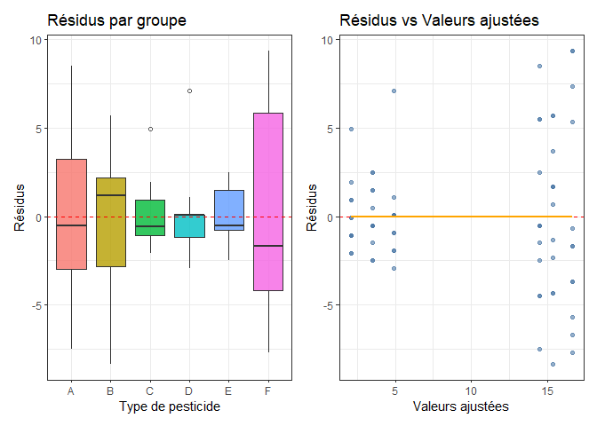
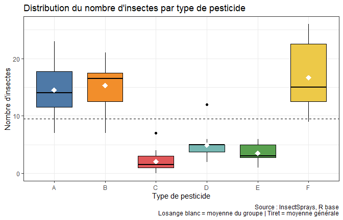
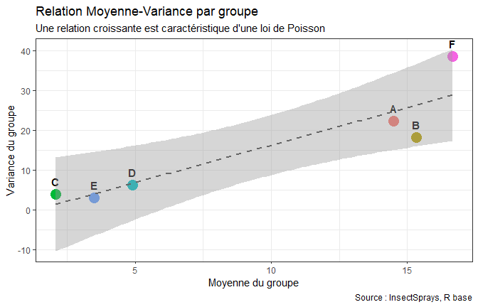
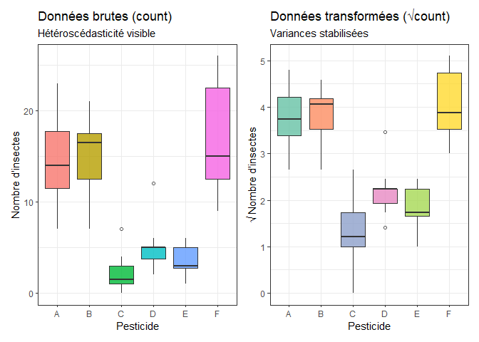
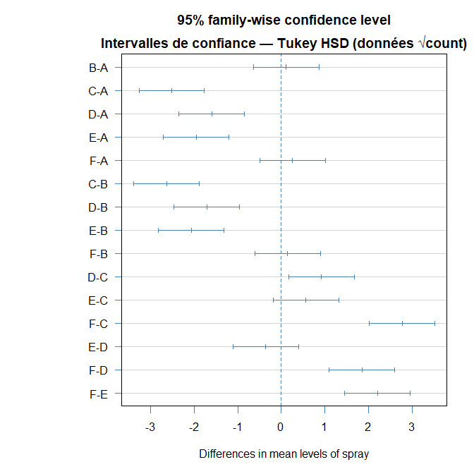

# Analyse de la variance à un facteur : diagnostic des hypothèses et méthodes correctives (base InsectSprays)

Projet de groupe, cycle des Ingénieurs Statisticiens Économistes, ENEAM, année académique 2025-2026, dans le cadre du Réseau des Écoles de Statistiques Africaines.

**Auteurs :** Honorat ASSOGBA, Antifa BADAROU, Ariel Angelo Kolawolé HOUNKPATIN et David NONVIDE. **Chef de groupe :** Ariel Angelo Kolawolé HOUNKPATIN.

**Rapport complet :** [Rapport-ANOVA-InsectSprays.pdf](Rapport-ANOVA-InsectSprays.pdf)

## Question

Les six insecticides de l'expérience de Beall (1942) ont-ils la même efficacité moyenne ? Et surtout : l'ANOVA classique est-elle valide sur ces données de comptage, et comment corriger ses limites quand ses hypothèses sont violées ?

## Données

Base `InsectSprays`, intégrée au logiciel R : 72 observations, soit 6 insecticides (A à F) appliqués sur 12 parcelles chacun. La variable réponse `count` est le nombre d'insectes dénombrés après traitement. Le plan est équilibré. Les données sont accessibles dans R avec `data(InsectSprays)`.

## Démarche

1. Rappels théoriques sur l'ANOVA à un facteur (modèle, hypothèses, décomposition de la variance, comparaisons multiples).
2. Analyse descriptive et diagnostic de surdispersion (rapport variance sur moyenne par groupe).
3. ANOVA classique.
4. Diagnostic : normalité des résidus (graphiques, Shapiro-Wilk global et par groupe) et homogénéité des variances (Levene, Bartlett).
5. Méthodes correctives : transformation racine carrée, transformation de Box-Cox, ANOVA de Welch, test de Kruskal-Wallis avec post-hoc de Dunn, et comparaisons de Tukey HSD.

Outil : R (`aov`, `car`, `ggplot2`, `dunn.test`).

## Résultats principaux

**ANOVA classique.** F(5, 66) = 34,7 (p < 2e-16). Le facteur spray explique 72,4 % de la variabilité totale (SCE = 2 669 sur SCT = 3 684). Mais cette conclusion n'est pas fiable en l'état :

| Hypothèse | Test | Résultat |
|---|---|---|
| Normalité des résidus | Shapiro-Wilk | W = 0,960 (p = 0,022), rejetée |
| Homogénéité des variances | Levene | F = 3,82 (p = 0,004), rejetée |
| Homogénéité des variances | Bartlett | K² = 25,96 (p = 9,1e-5), rejetée, à lire avec prudence car sensible à la non-normalité |

Le rapport variance sur moyenne par groupe, entre 1,19 et 2,31, indique une surdispersion par rapport à une loi de Poisson.

**Méthodes correctives.** Les cinq approches concluent toutes à un effet très significatif du type d'insecticide :

| Méthode | Résultat |
|---|---|
| Racine carrée puis ANOVA | Hypothèses satisfaites, méthode recommandée par le rapport |
| Box-Cox (sur count + 1) | lambda estimé à 0,284, intervalle de Wald à 95 % de 0,079 à 0,489, proche de la racine carrée |
| ANOVA de Welch | F = 36,065 (ddl 5 et 30,04), p = 8,0e-12 |
| Kruskal-Wallis | chi2(5) = 54,69, p = 1,5e-10 |

Les comparaisons de Tukey HSD distinguent deux groupes d'efficacité : les insecticides A, B et F (nombre élevé d'insectes) d'une part, C, D et E (nombre faible) d'autre part.

## Pistes d'amélioration

Pour des données de comptage, un modèle linéaire généralisé de Poisson, ou quasi-Poisson en présence de surdispersion, est l'approche naturelle. Il n'est pas traité dans ce rapport et constituerait une extension logique.

## Contenu du dépôt

| Fichier | Rôle |
|---|---|
| `Rapport-ANOVA-InsectSprays.pdf` | Rapport complet (36 pages), avec les extraits de code R |
| `figure-*.png` | Figures du rapport |

---
Ariel Angelo Kolawolé HOUNKPATIN, Ingénieur Statisticien Économiste, ENEAM, Université d'Abomey-Calavi
